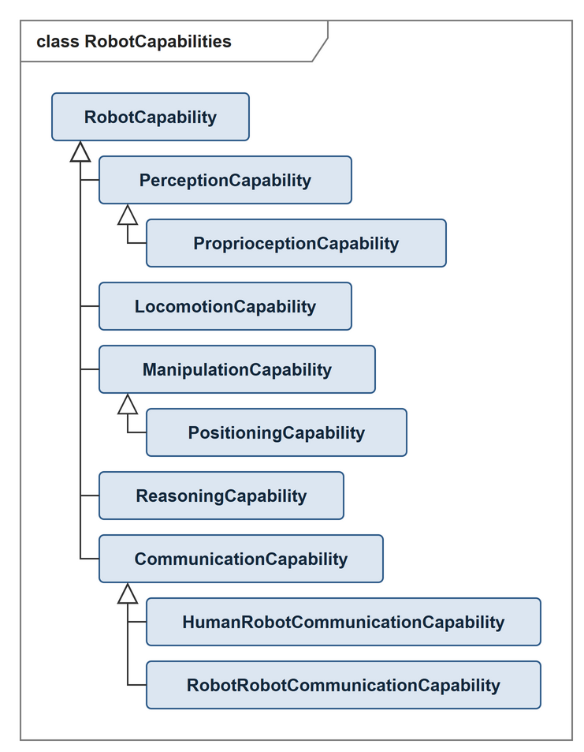

# RobotCapabilities — Basic Types of Capabilities of Autonomous Robots

A small, deliberately shallow taxonomy of the basic kinds of capability an
autonomous robot can provide, as types of `RobotCapability`.

The pattern **imports nothing**. An ontology that uses it places
`RobotCapability` under its own notion of capability with a single axiom --
for instance under
[`CSS:Capability`](https://github.com/CaSkade-Automation/CSS), the
"implementation-independent specification of a function" of the CSS reference
model, which is what
[CaSkBot](https://github.com/CaSkade-Automation/CaSkBot) does.

It fills a gap: there is **no standard** that fixes a taxonomy of capabilities
of autonomous robots. In manufacturing, capability types are commonly taken
from classification standards; for robotics no equivalent exists.

We maintain a list of standard-based ontology design patterns, see the
[Industry Standard ODP repository](https://github.com/hsu-aut/Industrial-Standard-Ontology-Design-Patterns).
**This pattern is not one of them.** It is an own definition, and it is named
accordingly rather than following the `IndustrialStandard-ODP-*` convention.

## The taxonomy

```
RobotCapability
 ├── PerceptionCapability
 │    └── ProprioceptionCapability
 ├── LocomotionCapability
 ├── ManipulationCapability
 │    └── PositioningCapability
 ├── ReasoningCapability
 └── CommunicationCapability
      ├── HumanRobotCommunicationCapability
      └── RobotRobotCommunicationCapability
```

Figure 1 shows the same taxonomy as a UML class diagram; hollow triangles denote
subclass relations. The types are not disjoint, and the correspondences to SOMA,
SRDL and IEEE 1872 are annotations, so neither appears in the figure.

<p align="center">

</p>

Figure 1: Class diagram of RobotCapabilities (editable source: [`pictures/robotcapabilities.drawio`](pictures/robotcapabilities.drawio), open with [draw.io](https://www.drawio.com))

## The cut is taken, not invented

The division is not a new proposal. Twelve groupings make the same
distinctions: locomotion appears in all of them, perception in eleven,
manipulation in ten, reasoning in six and communication in eight. They are not
twelve independent lines, though. SOMA and SRDL come from the same research
group, and Messina 2006 is the basis of the ASTM E54.09 standards, so at most
nine lines are independent. In that NIST line, communication means the radio
link rather than the exchange of information.

The starting point of the pattern, IEEE 1872 (part types `robotSensingPart`,
`robotActuatingPart`, `robotProcessingPart`, `robotCommunicatingPart`) and
IEEE 1872.2 clause 4.4.9 (function examples), is not counted among the twelve.

| Source | Perception | Locomotion | Manipulation | Reasoning | Communication |
|---|---|---|---|---|---|
| SOMA (ontology) | `Perceiving` | `Navigating` | `Actuating`, `Manipulating` | `DerivingInformation` | `CommunicationTask` |
| SRDL (ontology) | `PerceptionCapability` | `LocomotionCapability` | `ObjectManipulationCapability` | `ComputationalCapability` | — |
| Tiddi et al. 2017 (bottom-up from ROS) | Sensing | Movement | Movement | RobotKnowledge | — |
| ISO 8373:2021, 3.1 | — | locomotion | manipulation, positioning | — | — |
| SAE JAUS | Environment Sensing | Mobility | Manipulator | — | core services |
| SPARC MAR 2016, ch. 4 | Perception | Motion | Manipulation | Cognitive, Decisional Autonomy | Interaction |
| ASTM E54.09 | sensing | mobility | manipulation | — | communication |
| ASTM F3470-20 (A-UGV) | Localization | Goal Navigation, Docking | — | — | Fleet coordination |
| Zager et al. 2024 | Observe/Orient | Act: Locomotion | Act: Manipulation | Decide | Act: Communication |
| Paul & Nof 1979 (RTM) | sensing | actuation, positioning | actuation | decision making | — |
| Messina 2006 | Sensing | Mobility | — | — | Communications |
| ASyMTRe, Tang & Parker 2005 | perceptual schemas | motor schemas | motor schemas | — | communication schemas |

## Three different notions of "capability"

The word is used for three different things in the literature, and the
difference matters when these models are compared or combined:

| Source | A capability is … |
|---|---|
| **CSS, CaSk** | a **specification** — "implementation-independent specification of a function" |
| **SOMA, SRDL** | a **disposition** — "the disposition of an agent to bring about certain effects" |
| **ROSETTA, PMK** | a **property** of a skill or of the robot |

A specification is not a disposition: the specification "transport" exists
whether or not any robot has the disposition to carry it out. The
correspondences are therefore SKOS annotations and deliberately **not**
`owl:equivalentClass` — equating them would make every capability in this stack
a disposition. They say which kind of thing they point at:

- `skos:closeMatch` to `SRDL:Capability` and `SOMA:Capability` (the root) and to
  the four SRDL capability classes — dispositions, the same kind of thing with a
  different ontological commitment;
- `skos:relatedMatch` to the SOMA task types (`Perceiving`, `Navigating`,
  `Actuating`, `Manipulating`, `Positioning`, `DerivingInformation`,
  `CommunicationTask`, `Proprioceiving`) — activities a capability specifies,
  related but not interchangeable.

Note that `http://knowrob.org/kb/srdl2-cap.owl` identifies the SRDL terms but
does not dereference to RDF; the mappings name the terms without being able to
resolve them.

## Composite capabilities

The basic types are **not disjoint**, on purpose. A capability made up of
several basic kinds is given several types rather than a class of its own:

```turtle
ex:Localise  a RobotCap:PerceptionCapability , RobotCap:ReasoningCapability .
ex:Transport a RobotCap:LocomotionCapability , RobotCap:ManipulationCapability .
```

Application-specific capabilities — transporting, inspecting, guarding — belong
in the application ontology of the case at hand. A reusable pattern has to stay
independent of the task, so it is not the place for them.

Likewise, qualities such as configurability, dependability or energy efficiency
are **properties of** a capability, not types of it; model them with
[DIN EN 61360](https://github.com/hsu-aut/IndustrialStandard-ODP-DINEN61360).

## Exemplary competency questions

| ID | Competency question | Answer |
|---|---|---|
| 1 | Which basic types does a given capability belong to? | The types asserted on it; several for a composite capability |
| 2 | Which robots provide a perception capability? | Every resource that `CSS:providesCapability` an individual of `PerceptionCapability` |
| 3 | Which robots can communicate with another robot? | Every resource providing a `RobotRobotCommunicationCapability` |
| 4 | Does a robot providing a capability of a given type also have the parts that type presupposes? | Checked with SHACL; the coupling of capability and component follows SRDL and Buehler et al. 2014 |

## Usage

Import a fixed version:

```turtle
<http://example.org/my-ontology> rdf:type owl:Ontology ;
    owl:imports <http://www.w3id.org/hsu-aut/RobotCapabilities/2.0.2> .
```

The pattern imports nothing. The correspondences to SOMA, SRDL and
IEEE 1872 CORAX are annotations and pull in no further ontology.

## Developed at

Institut für Automatisierungstechnik (IfA), Helmut-Schmidt-Universität Hamburg.
